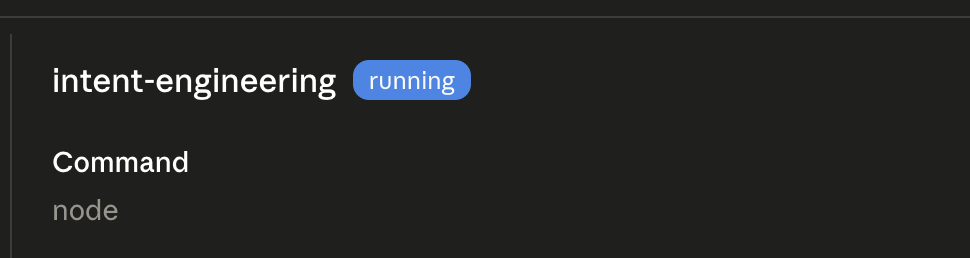

# intent-engineering

`intent-engineering` is an MCP server that exposes three tools — `audit_intent_spec`, `generate_intent_spec_scaffold`, and `assess_retrofit_level` — letting any MCP-aware client (Claude Desktop, Cursor, Anti-Gravity) review, scaffold, and triage agent intent specs against a 9-section unified template synthesized from production-agent research.

Most agent failures aren't reasoning failures — they're intent failures. The spec is vague, the stop rules are missing, the outcome is an activity disguised as a state. This server makes that gap auditable from inside the harness the agent already runs in. The full reasoning, the rejected alternatives, and what would break in v0 live in [`docs/EXPLANATION.md`](docs/EXPLANATION.md).

## The trust surface, up front

- **It audits itself, and it has now published a wrong number and a wrong correction of that number.** Graded whole on 2026-08-29, the canonical skill scores **23/25 with zero anti-patterns**. This page claimed 14/25 for one day, a retraction measured on the first 10,000 characters of a 32,356-character file. The original figure was right; the retraction was the error, and the same blind spot produced both. The full measurement table is in [Dogfood result](#dogfood-result-and-the-correction-that-came-with-it).
- **Read-only by design.** No tool writes files. The retrofit tool recommends; it does not apply.
- **File reads are guarded.** An early version would read any path you handed it, which made `/etc/passwd` a real disclosure bug. Every disk read now routes through one guard: extension allowlist, symlink resolution, root confinement, and a size cap.
- **The build refuses common failure modes.** SDK pinned to the stable v1.x line, a `prepublishOnly` guard that fails the build on any `console.log` in `src/`, and a changelog rule: no scope change without written approval before code.
- **Limitations are named, not hidden.** Stdio only, opinionated heading parser with its alias table documented, and the honest boundary that the mapper recognizes equivalent intent but does not invent it.

## Why this exists

### Problem
Engineering teams treat AI agents like reliable coworkers, but agents fail silently when given underspecified intent. The cost is shipped features that solve the wrong problem — and the failure mode is invisible until production. PMs feel this pain twice: once writing the spec, and again when an agent confidently delivers something off-target. There's no shared protocol for "audit this spec before an agent runs on it."

### Solution
A Model Context Protocol server that exposes three tools any MCP-aware client (Claude Desktop, Cursor, etc.) can call: `audit_intent_spec` audits a spec against a 25-item rubric, `generate_intent_spec_scaffold` scaffolds new specs by kind, `assess_retrofit_level` retrofits older docs. Published to npm as `@swins/intent-engineering-mcp` and to the official MCP registry as `com.seanwinslow/intent-engineering` via DNS-verified namespace.

### Tradeoffs and Decisions
- **TypeScript over Python**: the MCP TS SDK has the deepest client coverage (Claude Desktop, Cursor) — at the cost of locking out the Python-native data science crowd.
- **stdio transport over HTTP**: zero-infra v0, but couples the server to a process-bound client. v1 will add SSE for cloud agents.
- **DNS-verified namespace (`com.seanwinslow/*`) over GitHub-handle namespace**: locks the brand surface to a domain I control; required a separate Ed25519 keypair + apex TXT record, which is more upfront friction than `mcp-publisher login github`.

### What I Learned
The MCP protocol is essentially a contract for "I am a tool an LLM can call without me writing a wrapper." Once that landed, the server became a thin protocol adapter over an existing skill — and the OPTIONAL-fields pattern I'd developed on a separate knowledge-graph project translated directly.

The part I got wrong is the more useful lesson, and I got it wrong twice. I published a dogfood score of 23/25. Four months later I decided it had been a partial read reported as a whole-file grade, retracted it, and published 14/25 instead. The retraction was the actual error: the original had graded the whole file, and my replacement number was the partial read. Both were published because the tool's output could not tell you how much of the document it had just graded, so neither figure could be checked without going back to the source. **A tool that eats its own dog food earns credibility fast. A tool that makes its author's mistakes falsifiable earns more, and it is the harder thing to build.**

## Three tools

| Tool | Input | Output |
|---|---|---|
| `audit_intent_spec` | A spec (`spec_text` or `file_path`) | Score out of 25, per-section findings, detected anti-patterns, top 3 recommendations |
| `generate_intent_spec_scaffold` | `kind` (blank / level-1-mvr / full-9-section), optional hints | A paste-ready YAML scaffold + next-step actions |
| `assess_retrofit_level` | An existing prompt or SKILL.md | Recommended retrofit level (L1 / L2 / L3) with blast-radius + complexity + autonomy reasoning |

The 25-item validation checklist, 5 fatal anti-patterns, 4 autonomy levels, and 9-section template all come from the canonical [`intent-engineering` skill](https://github.com/seanwinslow28/claude-code-superuser-pack/tree/main/.claude/skills/intent-engineering). The MCP server is a thin protocol adapter, not a fork.

## Quickstart

Requires Node 20+ and an MCP-aware client (Claude Desktop, Cursor, etc.).

**One config entry, no clone.** Add this to `~/Library/Application Support/Claude/claude_desktop_config.json`:

```json
{
  "mcpServers": {
    "intent-engineering": {
      "command": "npx",
      "args": ["-y", "@swins/intent-engineering-mcp"]
    }
  }
}
```

**Or from source:**

```bash
git clone https://github.com/seanwinslow28/sw-mcp-intent-engineering.git
cd sw-mcp-intent-engineering
npm install
npm run build
```

Then point the config's `command` at `node` with `args: ["<ABSOLUTE_PATH_TO_REPO>/build/index.js"]`.

Restart Claude Desktop. Open Settings → Developer to confirm the server shows as `running`:



The three tools then appear in the tool list under `intent-engineering` in any new conversation.

## Try it

Paste this into Claude Desktop after the server is connected:

> Run `audit_intent_spec` on this spec:
>
> ```
> ## Objective
> Make support tickets resolve faster.
>
> ## Outcomes
> - Tickets close in <2h
> - CSAT stays high
>
> ## Stop Rules
> (none)
> ```

You'll get back a score out of 25, a list of detected anti-patterns (this spec hits at least three), and three concrete recommendations to fix it. The full I/O contract lives in [`docs/v0-scope.md`](docs/v0-scope.md) §4.

## Dogfood result, and the correction that came with it

**Re-measured whole-file 2026-08-29. The canonical `intent-engineering` SKILL.md scores 23/25 with zero anti-patterns detected.** Seven sections pass, two warn, none are missing. That is a grade of all 32,356 characters, and the `coverage` block in the response says so.

Reproduce it in one call:

```
audit_intent_spec({ file_path: "<path>/.claude/skills/intent-engineering/SKILL.md" })
```

### This page carried a wrong number, and then a wrong correction

The 23/25 above is the figure this page published in May 2026, retracted on 2026-08-28, and restored on 2026-08-29. The retraction was the mistake. Every measurement behind that sentence, so the reasoning can be checked instead of trusted:

| What was graded | Score | Anti-patterns |
|---|---|---|
| May-era file (17,885 chars), whole | **23/25** | none |
| May-era file, first 10,000 chars | 17/25 | 1 |
| Today's file (32,356 chars), whole | **23/25** | none |
| Today's file, first 10,000 chars | 14/25 | 2 |
| Any read starting past the end of the file | 1/25 at the time, **0/25** since | 2 |

**Why the original was right.** In May the skill was 17,885 characters. `max_length` caps at 20,000, so the whole file fit inside a single call and Phase 3's "first chunk" was the entire document. The `1/25` rows in that session's round-trip table were reads that started past the end and graded zero characters, not partial grades of real content. (That `1/25` was itself a small bug, fixed the same day as this re-correction: one conditional rubric item treated "not applicable" as a pass, so an unrecognized document collected a point. A document nothing is recognized in now scores `0/25`.)

**The number has never moved.** Graded whole, every revision of the skill in its git history scores the same:

| Revision | Characters | Whole-file score | Fits one 20,000-char call |
|---|---|---|---|
| `ebf41b3d` 2026-03-03 | 17,942 | 23/25, zero anti-patterns | yes |
| `9c76e762` 2026-05-04 | 17,885 | 23/25, zero anti-patterns | yes |
| `d0117843` 2026-06-10 | 17,900 | 23/25, zero anti-patterns | yes |
| `c8f90d79` 2026-07-05 | 32,356 | 23/25, zero anti-patterns | **no** |

The score is stable across five months and a commit that nearly doubled the file. It was also re-confirmed independently in a 2026-06-17 working session, when the file still fit in one call. What changed on 2026-07-05 was not the grade but the *measurability*: the file crossed the ceiling, and from then on no single call could check the published number.

**Why it was retracted anyway.** By July the skill had grown to 32,356 characters and crossed the 20,000-character ceiling, so no single call could grade it any more. The 2026-08-28 re-measurement used the 10,000-character default, got 14/25, saw that it did not match 23/25, and concluded the original had been a chunk mistaken for a file. That description of the error was exactly right and was applied to the wrong measurement. The chunk was the new one.

**The two mistakes have one cause.** For four months this tool could not tell you whether a score covered the whole document, and neither could its author. The May claim and the August retraction were both published without that fact being visible anywhere in the output. One happened to be right and one happened to be wrong, which is the least useful way to be correct.

Two things worth stating plainly, because this is a spec-auditing tool:

- **The tool was never wrong; the reading was, twice, in opposite directions.** `"14/25"` and `"23/25"` were the same shape of string. Nothing in the response distinguished a grade of 10,000 characters from a grade of 32,356, so both readings were unfalsifiable at a glance and both got published.
- **A correction is a claim and needs the same provenance as the thing it corrects.** The retraction was written carefully, cited its own session's table, and was still wrong, because it never asked what its replacement number had actually graded. Catching yourself is not the finish line. Catching yourself with a measurement that names its own denominator is.

**Fixed 2026-08-29, and this is what made the fix necessary.** `audit_intent_spec` now grades the whole document by default, and every response carries a `coverage` block naming the mode, the characters graded, the characters available, and whether the grade is complete. A partial grade can still be asked for. It can no longer be mistaken for a complete one.

At scale: the same server assessed all 118 first-party skills in my Claude Code Superuser Pack with zero parse errors, in under a second — both re-measured 2026-08-28 (94 ms, 0 errors, running the `scripts/audit-superuser-pack.ts` logic over the same 118 files). In the shipped CSV at `examples/superuser-pack-retrofit-assessment.csv` (2026-05), 24% scored L1-mvr (the spec just needs an intent header), 36% L2-structured (needs Health Metrics + Decision Authority), and 40% L3-full (autonomous-loop or high-blast-radius skills that warrant a 9-section conversion). The same files as they stand today split 20% / 38% / 42% — the corpus evolved, not the tool. `assess_retrofit_level` never had the hazard documented above: it has always read whole files and refused anything over 1 MiB loudly, so no batch grade in that CSV was ever a partial read. As of 2026-08-29 `audit_intent_spec` defaults to the same whole-document behavior.

## Limitations

The audit is opinionated about heading structure, but it now recognizes a conservative set of alias headings in addition to the canonical ones — `## Purpose` / `## When to Use` map to Objective, `## Success Criteria` / `## Definition of Done` to Desired Outcomes, `## Completion` / `## Exit Criteria` to Stop Rules, and so on (the full table lives in `src/intent/parser.ts`). When a section is recognized from a non-canonical heading the audit says so in its notes, so the score stays legible. Earlier, skills using different heading vocabularies scored 1/25 because *none* of their present sections were recognized; that false-negative is fixed. Two honest boundaries remain: headings that are *not* true intent equivalents (procedural ones like `## How to Apply`, `## Instructions`, `## Usage`) are deliberately left unmapped rather than credited to the wrong section, and a spec that genuinely lacks the nine intent sections still scores low — the mapper recognizes equivalent intent, it does not invent it.

Other v0 boundaries worth naming up front:

- **Read-only.** No tool writes files. `assess_retrofit_level` recommends; it does not retrofit. A v0.2 `apply_retrofit` would live behind explicit user confirmation.
- **Stdio transport only.** No Streamable HTTP, no SSE, no remote hosting. Run it locally next to your client.
- **No `prompts` or `resources` primitives.** Three tools and that's it. Adding more before the surface is stable would be premature.

## Project layout

```
sw-mcp-intent-engineering/
├── src/
│   ├── index.ts                    # MCP server boot + tool registration
│   └── intent/
│       ├── audit.ts                # audit_intent_spec logic
│       ├── scaffold.ts             # generate_intent_spec_scaffold logic
│       ├── retrofit.ts             # assess_retrofit_level logic
│       ├── checklist.ts            # 25-item validation checklist
│       ├── anti-patterns.ts        # 5 fatal anti-pattern detectors
│       ├── parser.ts               # YAML frontmatter + markdown heading parser
│       └── templates/              # YAML scaffolds (blank / level-1-mvr / full-9-section)
├── docs/
│   ├── v0-scope.md                 # binding scope-lock for v0
│   ├── EXPLANATION.md              # 4Q comprehension artifact (why MCP, what would break, what I learned)
│   └── claude-code-responses-and-tests/   # archived phase-verification outputs
├── package.json
├── tsconfig.json
├── server.json                     # registry metadata
├── CHANGELOG.md
├── README.md
└── LICENSE
```

`src/index.ts` is a thin protocol adapter. All tool logic lives in `src/intent/*`.

## Build discipline

- SDK pinned at `@modelcontextprotocol/sdk@1.29.0` (stable v1.x line, not the v2 pre-alpha)
- All logging goes to `console.error`. A `prepublishOnly` grep guard fails the build if any `console.log` appears in `src/`
- Tool implementations import the validation checklist, anti-pattern definitions, and template strings from local modules that mirror the skill. They do not paraphrase or reinvent skill content
- Scope changes require explicit approval in [`CHANGELOG.md`](CHANGELOG.md) before code is written

## Further reading

- [`docs/EXPLANATION.md`](docs/EXPLANATION.md) — the 4Q comprehension artifact (what this is, why this approach, what would break, what I learned)
- [`docs/v0-scope.md`](docs/v0-scope.md) — binding v0 scope-lock and ship gate
- [seanwinslow.com/transactions/intent-engineering-mcp](https://seanwinslow.com/transactions/intent-engineering-mcp) — deep-dive write-up with Loom demo

## License

MIT. See [`LICENSE`](LICENSE).
